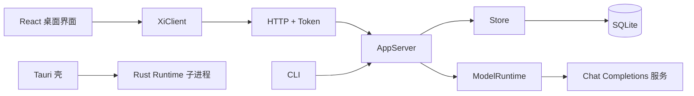

# 第四步：桌面端、AppServer 与调试

桌面端只负责界面和交互，Runtime 负责业务、模型调用和 SQLite。CLI 与桌面端共享同一个 AppServer，因此项目、会话、消息和模型服务的行为保持一致。



## 代码边界

| 位置 | 责任 |
| --- | --- |
| `app/src/App.tsx` | 页面状态、会话导航、发送和模型选择 |
| `app/src/components/ProjectPicker.tsx` | 项目搜索、切换、创建入口和独立聊天入口 |
| `app/src/components/SettingsPage.tsx` | 偏好和模型服务设置 |
| `app/src/client/` | 类型、业务客户端和 HTTP 适配器 |
| `app/src/platform/runtime.ts` | 获取 Runtime Token 和目录选择能力 |
| `src-tauri/src/main.rs` | 桌面窗口、Token 和 Runtime 子进程 |
| `src-tauri/src/project_directory.rs` | Windows 文件夹选择器 |
| `src/app_server.rs` | 项目、会话、Provider 和聊天业务 |
| `src/http.rs` | HTTP 解析、鉴权、CORS 和路由 |
| `src/model.rs` | 模型请求、SSE 和模型能力 |
| `src/storage.rs`、`src/storage/providers.rs` | SQLite 及模型服务持久化 |

React 不读数据库，也不接触已保存的 API Key。组件只调用 XiClient；新增传输方式时实现新的适配器即可复用业务层。

## 项目与会话

项目绑定现存的本地目录。输入区上方的 ProjectPicker 支持按名称或路径搜索、创建项目和切换独立聊天。草稿会按会话保存在当前窗口；已有会话切换项目时调用移动接口，未发送的草稿不会丢失。

新会话先是内存草稿，首条消息才创建数据库会话。发送前必须明确会话、Provider、模型和推理档位。历史加载失败时页面提供重试，并禁止向空白视图发送消息。

## Provider、模型与推理

模型服务设置只管理地址、密钥和模型缓存；具体模型在输入区选择。模型描述包含 `reasoning_efforts` 与 `reasoning_source`，能力可来自服务声明、精确型号预设或逐模型自定义。未知型号不覆盖服务默认值。

“默认”表示省略 `reasoning_effort`；显式 `none` 是实际参数。切换 Provider、模型或新会话时恢复默认，服务端在保存消息前再次校验能力。详见[模型能力](../model-capabilities.md)。

## 一次聊天请求

```text
用户选择项目、会话、Provider、模型和推理
  → XiClient 发送明确目标
  → AppServer 校验配置和会话
  → 事务保存 user、assistant 占位消息与 run
  → ModelRuntime 请求服务
  → 完成、失败或中断时更新消息和 run
```

校验失败不写入消息。网络失败会保留用户消息、错误状态和已收到的部分回复；只有 `complete` 消息进入下一轮上下文。SQLite 事务不跨网络请求，聊天及会话管理通过全局锁协调，避免迟到回复破坏历史。

## HTTP 调试

Runtime 绑定 `127.0.0.1`，桌面端通过 Tauri command 获取随机 Token。业务请求带 `X-Xi-Token`，预检请求返回 204 但不绕过业务鉴权。请求头和请求体有大小上限，重复长度字段、分块传输和畸形请求会被拒绝。

页面初始化最多重试 Runtime 连接；如果 Provider 操作失败，先检查 Runtime 是否运行、Token 是否有效、CORS 预检是否返回 204，再检查模型服务地址和凭据。不要把带 Token 的 URL、数据库或真实 Key 写入日志和文档。

## 验证

```powershell
cargo fmt --check
cargo test --offline --locked
cargo clippy --offline --locked --all-targets --all-features -- -D warnings
cargo build --offline --locked
npm --prefix app run build
cargo check --offline --locked --manifest-path src-tauri/Cargo.toml
node --experimental-strip-types --test app/tests/client.test.mjs app/tests/preferences.test.mjs app/tests/models.test.mjs app/tests/runtime.test.mjs
```

Rust 测试覆盖 HTTP 边界、目录项目、运行状态和模型能力；Node 测试使用临时数据库及本机 mock 服务。实际桌面验收还应检查窗口居中、项目选择器、目录选择器、草稿隔离、失败恢复和不同模型的推理菜单。

当前仍未实现工具执行、上下文预算、事件订阅、Turn 调度、取消、远程 Runtime、完整 JSON-RPC、其他原生模型协议和正式 sidecar 分发。这些能力需要独立设计，不应通过增加旧协议兼容分支临时拼接。
