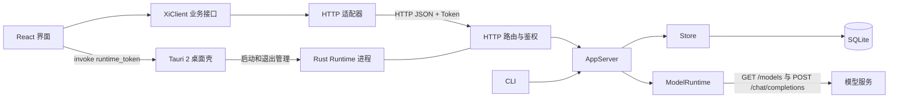

# 第四步：应用端、App Server 与 SQLite

前三步解决了请求、多轮历史、关系化存储和流式 CLI。本阶段把操作搬到桌面界面，让 Provider、分组、会话、消息和运行状态共用同一个 App Server。本文描述当前代码，不把目标架构当成已完成能力。

## 1. 让不同 UI 共用 App Server



| 位置 | 责任 |
| --- | --- |
| `app/src/App.tsx` | 表单、会话导航、消息展示、模型和推理强度选择 |
| `app/src/client/XiClient.ts` | 可注入的客户端业务接口，不依赖 React、Tauri 或 HTTP |
| `app/src/client/http.ts` | 将业务操作映射为 HTTP 请求，传递 Token 和接口错误 |
| `app/src/api.ts` / `app/src/platform/runtime.ts` | 装配客户端，以及获取 Tauri/Web 的 Runtime 凭据 |
| `src-tauri/src/main.rs` | 生成 Token、启动 Runtime 子进程、退出时清理子进程 |
| `src/main.rs` / `src/cli.rs` | 进程装配 / CLI 命令与流式输出，两种入口调用同一个 App Server |
| `src/protocol.rs` | 与 UI、传输无关的业务请求和响应类型 |
| `src/app_server.rs` | Provider、分组、会话、消息和聊天业务入口 |
| `src/http.rs` | HTTP 解析、Token 鉴权、CORS 和路由映射 |
| `src/model.rs` / `src/storage.rs` | 模型调用与 SQLite 读写 |
| `src/storage/providers.rs` / `src/storage/migration.rs` | Provider 读写 / 旧客户端快照只读导入 |
| `docs/app-api.md` | 客户端请求约定 |

React 不直接读数据库或持有已保存的 Key；Tauri 不处理聊天业务。组件只调用 `XiClient`，服务端的 `AppServer` 也不接收 HTTP body 或返回 HTTP response。新增 UI 可以复用客户端，采用其他传输时只需增加适配器，不必复制模型调用和存储逻辑。

这借鉴了 Codex App Server 将客户端与运行逻辑分离的思路；xi 没有依赖 Codex SDK 或二进制。`XiClient` 中的 `session/create`、`chat/send` 是内部操作名，当前实际通信仍为 HTTP JSON，并非 JSON-RPC 或事件流。

旧 HTML 原型调用已移除的配置接口，与 React 形成两套行为。本次整理移除旧页面；Runtime 根路径现在只返回受 Token 保护的状态 JSON，桌面 UI 统一放在 `app/`。

## 2. Provider 与聊天模型分开

Provider 表示“通过哪个地址、用哪组凭据连接服务”。模型和推理强度表示“这次消息怎样调用服务”。二者的生命周期不同。

配置流程：

1. 输入 API 地址和 Key。地址输入框失焦时，名称为空才自动回填，手动名称不覆盖。
2. 点击“获取模型”，Runtime 请求 `{base_url}/models`，解析 `data[].id`。
3. 表单展示模型数量及完整列表，无需在配置页选择模型。
4. 保存配置和模型缓存；对话区使用当前 Provider 的缓存列表选择模型。

例如 `https://api.nassaapi.xyz/v1` 会生成 `nassaapi`。当前规则取主机名倒数第二段，适合该示例，不是完整的公共后缀解析器。

新增配置还没有 ID，获取的列表暂存在表单中；保存时再持久化。编辑配置时可以只传 `id`，由 Runtime 读取已保存的 Key，查询接口只返回 `api_key_configured`，不返回真实 Key。

模型列表直接使用 `providerForm.models` 渲染，避免另设一份列表 state。否则表单已更新、展示列表未更新时，就会出现“接口成功但页面看不到模型”的状态分歧。

聊天请求示例：

```json
{
  "content": "解释一下这段代码",
  "session_id": "session-example",
  "provider_id": "provider-example",
  "model": "model-a",
  "reasoning_effort": "medium"
}
```

“自动”模式省略 `reasoning_effort`。这些选择随本次请求发送，不回写 Provider 的旧 `model` 字段。后者仍供 CLI 和默认值回退使用；新配置中该字段可以为空。

### 窗口选择与服务端默认项分开

不同窗口各自维护当前会话和 Provider。读取消息、发送消息和清空历史都明确指定会话 ID；聊天同时指定 Provider ID。窗口 A 选会话 A、窗口 B 选会话 B 时，A 的请求仍写入 A，不会因为服务端默认项改变而写进 B。

旧 HTTP 请求不传 ID 时仍使用服务端默认项，保持旧调用方式可用；传了不存在的 ID 则直接报错，不回退到其他对象。新客户端只有首次初始化会读取默认项，普通切换只改变本地选择。服务端在调用模型前固定配置，调用期间切换默认 Provider 不会改变这一轮请求。

异步读取还需要防止迟到响应：React 用 `selection` 引用标识一次选择。读取消息后先检查选择是否仍相同，用户已切换时就丢弃旧结果，避免会话 A 的消息覆盖会话 B。

## 3. SQLite 存了什么

数据库沿用主线的平台用户数据目录（Windows 为 `%LOCALAPPDATA%\xi\xi.db`）；`XI_DATA_DIR` 可指定独立目录，文件名为 `xi.db`。桌面交互测试必须显式指定测试目录，避免访问用户真实数据。

| 表 | 内容 |
| --- | --- |
| `providers` | ID、唯一名称、API 地址、Key、旧模型字段、时间戳 |
| `provider_models` | Provider ID 与模型 ID，以两者组成主键 |
| `conversation_groups` / `conversations` | 分组、会话、模型与归档状态 |
| `messages` / `runs` | 有序消息、部分回复和运行状态 |
| `app_state` | 默认选择与一次性导入标记 |

客户端原型曾把分组和消息作为 JSON 快照放入 `app_state`。当前已统一到第三步的关系表，工作区 API 按需查询这些表，不再维护另一份内存历史或反复改写整个快照。

`Arc<AppServer>` 让连接线程共享业务服务，`Mutex<Store>` 保护 SQLite 连接。创建消息和 run、清空历史、删除会话等操作使用短事务。网络调用时释放数据库锁，流式输出首块落库，后续按时间或字节数节流保存，结束或失败时保存完整结果。

当前另有全局 `chat_lock` 串行执行聊天，清空、删除、归档和移动也通过同一把锁协调，避免迟到回复写入已清空的历史。进程实例锁阻止两个 Runtime 同时恢复同一数据库的活动请求。它们还不是按会话调度、可取消的 Turn 系统；多个 UI 应连接同一个服务。

Provider 创建、更新、缓存和删除使用事务；启用 SQLite 外键，删除 Provider 时级联清理模型缓存。模型缓存目前通过 `INSERT OR IGNORE` 追加，不会自动移除服务商下架的模型。API Key 当前明文保存，不能把数据库当作可公开提交的测试文件。

启动时将原型数据库 `config/xi.sqlite3` 的快照、Provider 和模型缓存只读导入目标数据库，来源文件保留。读取使用一致性事务；目标导入整体提交，并记录来源标记。重复启动不重复导入，失败也不留下半份会话。设置 `XI_DATA_DIR` 后仅检查测试目录，迁移测试不能触碰真实凭据。更详细的表结构和状态语义见 [03-会话持久化与分组](03-会话持久化与分组.md)。

## 4. 用户消息为何要先保存

```text
前端立即展示用户消息
  → 客户端按需创建会话，发送明确的会话和 Provider ID
  → AppServer 校验配置与目标会话
  → 在事务中保存 user、assistant 占位消息与 run
  → 调用模型
  → 成功、失败或中断时更新 assistant 与 run 状态
```

前端即时展示解决等待期间“消息消失”的观感；后端先持久化解决模型请求失败或重启后的数据恢复。两者缺一不可。无效配置或不存在的目标在写入前报错；有效请求调用模型失败时，用户消息保留，不伪造 assistant 回复。

页面读取带状态的 history 接口，展示已有的中断文本；搜索、会话移动、归档和 Markdown 导出也通过 XiClient 调用 AppServer。删除分组会把会话移到“未分组”，删除会话才会永久移除消息，确认弹窗必须准确说明两者区别。

启动时只创建受保护的“未分组”，不自动插入空会话。当前 React 的“新会话”按钮只打开本地草稿，发送首条消息时才创建会话并根据内容生成标题。模型和推理选项位于输入框右下角；Enter 发送，Shift + Enter 换行，输入法组合输入期间不触发发送。

## 5. Tokio：Future 必须在正确的上下文执行

模型列表曾出现连接被意外关闭，Runtime 日志包含：

```text
there is no reactor running, must be called from the context of a Tokio 1.x runtime
```

原因是普通 HTTP 连接线程在进入 Tokio 前调用了 `RequestBuilder::send()`。项目使用的 reqwest 会在构造请求 Future 时创建超时计时器，这一步就需要 Tokio 上下文。

容易出错的形式：

```rust,ignore
runtime.block_on(client.get(endpoint).send());
```

参数先求值，不能只因外层有 `block_on` 就认为里面每个动作已经在 Runtime 中执行。当前同步进程入口由 `ModelRuntime` 持有 Tokio Runtime 和复用的 HTTP 客户端，将完整网络操作放进 `block_on` 的异步块：

```rust,ignore
self.runtime.block_on(async {
    let response = self.client.get(endpoint).send().await?;
    response.text().await
})
```

这样请求构造、发送和读取响应都在异步任务内发生。聊天也复用同一执行方式；HTTP 客户端复用连接池，不为每次请求重新创建。

## 6. 为什么 PowerShell 成功、页面却 Failed to fetch

实际排查中，直接调用模型服务和 Runtime API 都成功，但 Tauri 页面 Provider 列表为空，按钮操作显示 `Failed to fetch`。

前端来自 `http://localhost:1420`，Runtime 在 `http://127.0.0.1:43127`，端口和主机不同，属于跨源请求。PowerShell 不执行浏览器的 CORS 检查，所以接口测试成功不能证明 WebView 可以访问。

页面请求带有 `Content-Type: application/json` 和 `X-Xi-Token`，浏览器会先发送 `OPTIONS` 预检。修复包括：

- `OPTIONS` 在业务鉴权前返回 204，因为预检本身不携带实际业务 Token。
- 响应允许 `Content-Type`、`X-Xi-Token` 以及 `GET, POST, OPTIONS`。
- 实际业务请求仍校验 Token，不能把预检放行等同于业务放行。
- `api.ts` 装配 Runtime 地址和 HTTP 适配器，平台模块从查询参数或 Tauri command 获取 Token。

当前 CORS 使用 `Access-Control-Allow-Origin: *`，这是本机原型的实现，并非来源白名单。未来开放远程服务时，需要单独设计可信来源、身份认证和传输安全。

页面首次加载还有最多 8 次、间隔 250 ms 的重试，用于处理 Runtime 子进程就绪时序。**重试无法修复缺少 CORS 响应头的问题。** 应先确认具体错误，再决定是否重试。

## 7. 如何验证这一阶段

在仓库根目录、已有依赖的环境中运行：

```powershell
cargo test --offline --locked
cargo clippy --offline --locked --all-targets --all-features -- -D warnings
npm --prefix app run build
cargo build --offline --locked
node --experimental-strip-types --test app/tests/client.test.mjs app/tests/runtime.test.mjs
cargo check --offline --locked --manifest-path src-tauri/Cargo.toml
```

验证按调用链分层，避免只看一个成功状态：

| 层次 | 检查 |
| --- | --- |
| Runtime | 无 Token 返回 401；预检返回 204；携带 Token 的业务请求成功 |
| Provider | 获取模型返回非空列表；编辑时留空 Key 能继续使用已保存值 |
| React | 地址失焦回填名称；模型列表可见；配置页没有模型必选框 |
| 对话 | 从下拉框切换模型，发出的请求使用该模型；失败后用户消息仍在 |
| 输入与管理 | Enter 发送一次、Shift + Enter 换行；重命名点击按钮后输入；删除先确认；“未分组”没有重命名和删除入口 |
| 多客户端边界 | 修改默认项后，显式会话和 Provider ID 仍指向原目标；指定清空不影响另一会话 |
| 客户端适配 | 无浏览器或 Tauri 的测试中注入传输，检查目标 ID、查询编码和错误传播 |
| 恢复 | 重启后 Provider、缓存和已有工作区仍能恢复 |

不要将真实 Key、带 Token 的启动 URL、数据库或包含凭据的调试截图写进学习文档。使用占位值和测试数据，保持验证可重复。

Rust 集成测试使用临时 SQLite 和本机 mock 模型服务，验证目标隔离、模型和推理强度转发、模型失败后用户消息保留，以及数据库重开恢复。它不等于已验证真实服务商或多端界面；浏览器 CORS 和桌面交互仍需单独验收。

客户端原图、生成提示词和 Tauri 图标转换命令见 [图标说明](../../app/assets/xi-icon-prompt.md)。页面、窗口与程序资源使用同一图形，避免只改了侧栏标识而桌面程序仍显示默认图标。Tauri 的 `gen/schemas/` 属于构建生成文件，不随业务源码提交。

## 8. 当前仍未完成

- CLI 优先使用 Provider 的旧模型字段，为空时使用模型缓存第一项，尚未提供独立模型选择交互；消息已通过 AppServer 持久化。
- CLI 保留流式输出，桌面 HTTP API 等待完整结果；仍串行执行，尚未实现 Turn 调度、客户端事件订阅、取消、工具调用和权限审批。
- 正式安装包尚未配置完整的 Runtime sidecar 分发；路径目前以 Windows 开发环境为主。
- Web 和移动端的完整适配、远程 Runtime、JSON-RPC 和事件流仍属后续工作。

现有 HTTP 路由与响应字段保持可用；新增历史、移动、归档、搜索和导出接口。数据库保留主线关系表，并增加 Provider 表、schema 版本 2 与快照导入。后续实现事件与取消时，应在这些业务边界上继续演进，并明确协议版本与兼容方式。
